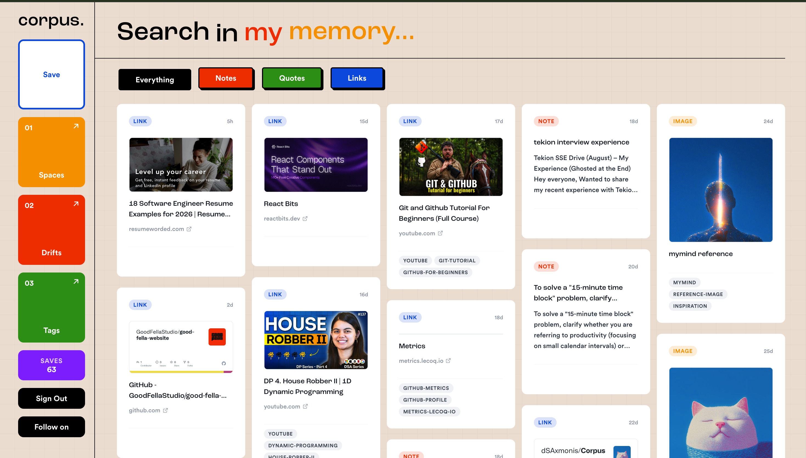
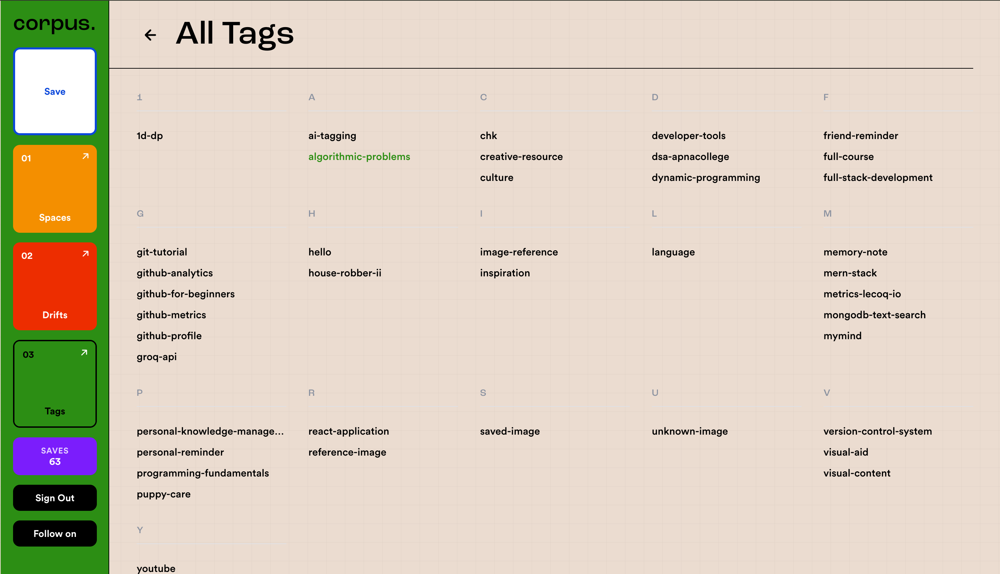
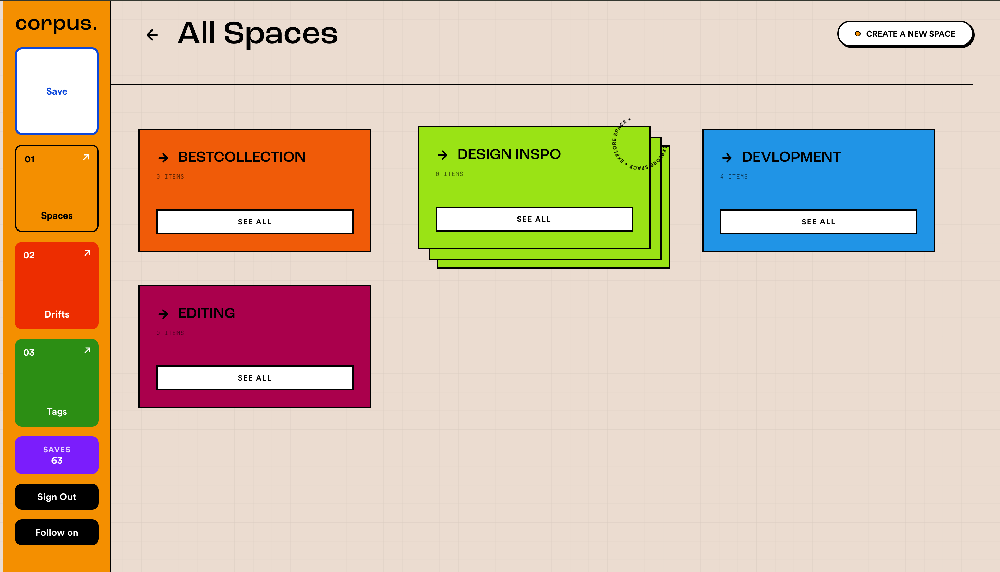
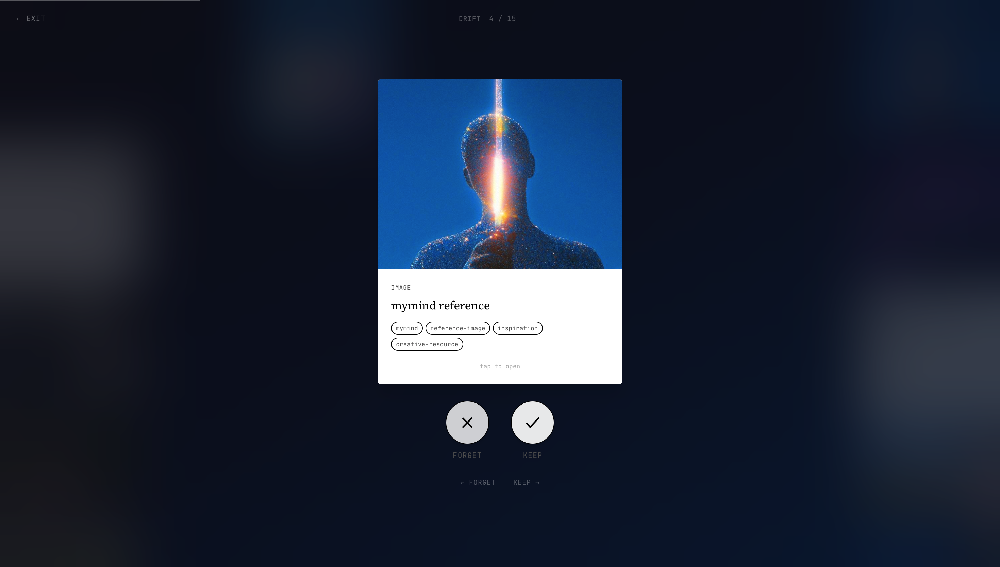

# Corpus

> Your personal knowledge base — save anything, find it later.

Corpus is a full-stack personal knowledge management app. Save links, notes, and images from anywhere on the web, and let AI organize them for you — so nothing you find ever gets lost again.


---

## ✨ Features

- **Save from anywhere** — Chrome extension lets you save links, selected text, and images in one click, right from your right-click menu.
- **AI-powered organization** — Automatic TLDR generation and auto-tagging (via Groq/LLaMA) so every save is summarized and categorized without manual effort.
- **Smart Search** — Full-text and semantic search across everything you've ever saved.
- **Spaces** — Group related saves into dedicated collections/projects.
- **Drift Mode** — Resurfaces old saves at random, so forgotten gems don't stay forgotten.
- **Persistent login** — Sign in once via the extension; stays authenticated for months using secure token refresh, no repeated logins.
- **Credit system** — Usage-based limits for AI features.

---

## 📸 Screenshots
 
### Web App — Dashboard

 
### Tags Search

 
### Spaces

 
### Drift Mode


---

## 🛠️ Tech Stack

| Layer         | Tech                                      |
|---------------|--------------------------------------------|
| Frontend      | React, MERN stack                          |
| Backend       | Node.js, Express                           |
| Database      | MongoDB                                    |
| AI            | Groq (LLaMA) — summarization & tagging     |
| Auth          | JWT (access + refresh tokens)              |
| Security      | AES-256-GCM envelope encryption, pluggable KMS, audit log |
| Deployment    | Vercel (frontend), Render (backend)        |

---

## 🔐 Security & Privacy

User content is **encrypted before it reaches the database**, with a key unique to each account.

- **Envelope encryption.** Each user has their own 256-bit data key, stored only in wrapped form under a master key that never touches MongoDB. The master key comes from an env var or **Google Cloud KMS**, behind a pluggable provider.
- **Field-level AES-256-GCM**, bound to the owner and field via AAD. Tag filters and duplicate detection use per-user **blind indexes**.
- **Crypto-shredding.** Deleting an account destroys its key, so its data is unreadable even in old backups.
- **Access log.** Every decrypt, whether by the user or by a background AI job, is recorded. Users can view it and download it as CSV.
- **Hardened auth.** Refresh tokens are hashed and rotated, with theft (reuse) detection; OTPs are HMAC-hashed with an attempt lockout; layered rate limits; strict CORS.
- **Private media.** Uploads are served via expiring signed URLs.
- **User controls.** Export all data as JSON, sign out everywhere, delete account.
- **PDFs.** Encrypted file storage; every page searchable through an encrypted word index and semantic vectors; AI summaries and key points; parsing in a locked-down worker thread; a restart-safe job queue; a per-item "keep away from AI" switch.

Threat model, diagrams, trade-offs and runbooks: **[docs/SECURITY_ARCHITECTURE.md](docs/SECURITY_ARCHITECTURE.md)**

---

## 🚀 Getting Started

### Prerequisites
- Node.js (v18+)
- MongoDB instance (local or Atlas)
- Groq API key

### Setup

```bash
# Clone the repo
git clone https://github.com/dSAxmonis/corpus.git
cd corpus

# Install dependencies
npm install

# Set up environment variables
cp corpus-server/.env.example corpus-server/.env
# Add your MongoDB URI, JWT secrets, Groq API key, and an encryption key:
node -e "console.log(require('crypto').randomBytes(32).toString('base64'))"  # → DATA_ENCRYPTION_KEY

# Run locally
npm run dev

# Tests (needs a MongoDB to create throwaway databases in)
cd corpus-server && TEST_MONGO_URI=mongodb://127.0.0.1:27017 npm test
```


## 📁 Project Structure

```
corpus/
├── client/          # React frontend
├── server/          # Express backend & API
├── assets/           # README images/screenshots
└── README.md
```

---

## 🗺️ future roadmap
- [x] Vector search / RAG for semantic recall
- [x] Encryption at rest with per-user keys
- [ ] Encrypted embeddings
- [ ] Redis caching layer
- [ ] CI/CD pipeline
- [ ] Mobile app

---

## 📄 License

MIT
---
🌱 made my Monis

