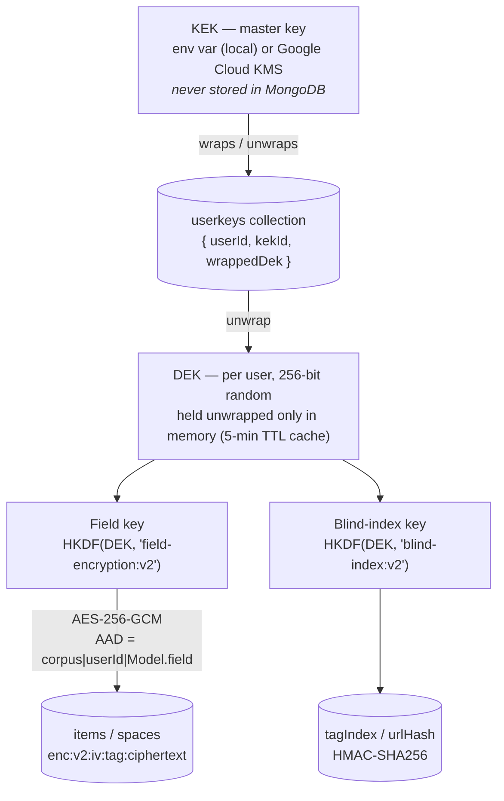
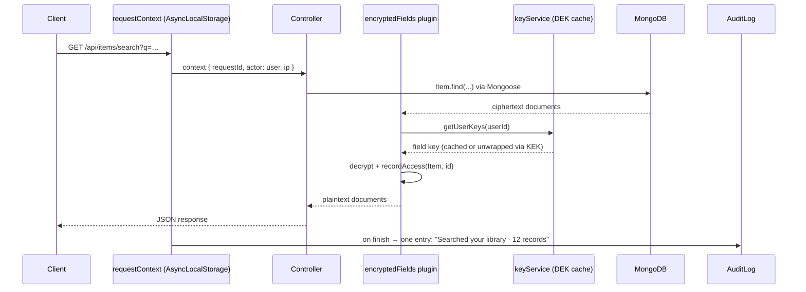
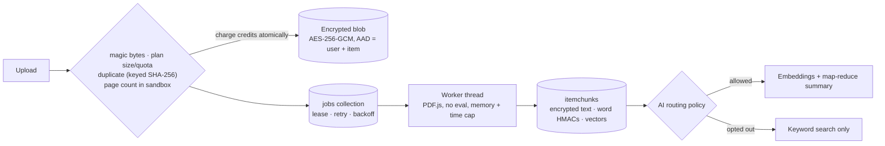

# Corpus — Security Architecture

Corpus stores people's private notes, links and documents. This document explains how that data is protected, the threat model behind the design, the trade-offs we chose deliberately, and the runbooks for operating it.

> **One-line summary:** application-layer envelope encryption with per-user keys, a pluggable KMS-backed master key, crypto-shredding for deletion, and a user-visible access log, without giving up server-side AI features.

---

## 1. Threat model

| Threat | Mitigation | Status |
|---|---|---|
| Database leak / stolen backup / over-privileged DB operator | Field-level AES-256-GCM; keys never stored unwrapped in the DB | ✅ |
| Attacker copies ciphertext from one user/field into another | AAD binds every ciphertext to `userId` + field | ✅ |
| Ciphertext tampering | GCM authentication tag, so a tampered value fails to decrypt (returns empty, never garbage) | ✅ |
| Master-key compromise | KEK rotation re-wraps all DEKs without re-encrypting data; optional Cloud KMS (key never leaves the HSM) | ✅ |
| "Right to be forgotten", including backups | Crypto-shredding: destroy the user's DEK, and every copy of their ciphertext is unreadable | ✅ |
| Stolen refresh token | Tokens hashed at rest, rotated on every use; replay of a rotated token revokes all sessions | ✅ |
| OTP brute force | `crypto.randomInt`, HMAC-hashed at rest, 5-attempt burn, per-IP+email rate limit | ✅ |
| Credential stuffing / API abuse | Layered rate limits (auth, OTP, email, item creation, global) | ✅ |
| Cross-site requests from unknown origins | Explicit CORS allowlist (env-driven), no wildcard private-network origins in production | ✅ |
| Guessable media URLs | Cloudinary `authenticated` assets in per-user folders, served via expiring signed URLs | ✅ |
| Silent server-side access to user data | Every decrypt is attributed (user request or system job) and logged; users can view/download it | ✅ |
| **Compromised application server** | Out of scope: the server must read content for AI features (see §6) | ⚠️ accepted |

---

## 2. Key hierarchy (envelope encryption)



- **KEK provider is pluggable** (`services/keys/`). `local` derives a wrap key from `DATA_ENCRYPTION_KEY`; `gcp-kms` calls Cloud KMS `encrypt`/`decrypt`, so the KEK lives in Google's HSM, access is IAM-controlled, and every unwrap is in Cloud Audit Logs. Adding AWS KMS or Vault means implementing `wrap()`/`unwrap()`.
- **Every wrapped DEK records its `kekId`**, so multiple KEKs can coexist during rotation.
- **Domain separation:** the field key and blind-index key are derived separately with HKDF, so neither can be used to attack the other.
- **Destroying a DEK makes all of that user's data unreadable** (crypto-shredding), including in backups taken before deletion.

## 3. What is encrypted

| Collection | Encrypted (AES-256-GCM) | Blind index (HMAC) | Plaintext (and why) |
|---|---|---|---|
| `items` | title, content, url, thumbnailUrl, faviconUrl, summary, note, tags[] | `tagIndex[]` (tag filter), `urlHash` (duplicate detection) | `userId`, `spaceId`, `type`, `contentType`, `status`, timestamps (needed for queries/sorting); `embedding` (needed by Atlas Vector Search, §6) |
| `spaces` | name | — | `userId`, `color`, timestamps |
| `users` | — | — | email (login lookup), name, plan; `passwordHash` is bcrypt; `refreshTokens` are SHA-256 hashes |
| `otps` | — | — | `otpHash` is HMAC-SHA256 keyed by a server secret |
| `auditlogs` | — | — | ids and metadata only, never content |

Blind indexes are **keyed per user**: the same tag saved by two users produces unrelated hashes, so equality across accounts can't be inferred.

## 4. How it's wired



- **Transparent to business logic.** `models/plugins/encryptedFields.js` encrypts in `pre('save')` and update hooks and decrypts in post-query and aggregate hooks. Controllers work with plaintext and never call crypto directly, except to compute a blind index for a filter.
- **Background work is attributed honestly.** `runAsSystem('AI tagging & summary', fn)` gives jobs their own context, so their decrypts show up in the user's log as *Corpus server · AI tagging & summary*.
- **Keyword search runs in-app** over decrypted candidates, because MongoDB `$text`/`$regex` can't index ciphertext. Semantic search still uses Atlas Vector Search.

## 5. Authentication hardening

- Access JWT: 15 min, httpOnly cookie. Refresh JWT: 7 days, contains a unique `jti`, httpOnly cookie.
- **Refresh rotation with reuse detection.** Each refresh consumes the presented token. Re-presenting a consumed token signals theft, so *all* sessions are revoked and an `auth.token_reuse` event is logged. A 30-second grace window keeps simultaneous refreshes from multiple tabs from tripping this.
- Setting a password signs out every other session.
- OTPs: CSPRNG, HMAC at rest, timing-safe compare, burned after 5 failures, 60-second resend cooldown.
- Security events (`auth.login`, `auth.login_failed`, `auth.logout_all`, `auth.token_reuse`, …) go to the same user-visible log.

### Redis: shared, short-lived security state
| Key | Purpose | TTL |
|---|---|---|
| `rl<n>:<ip/user>` | Rate-limit counters shared by all instances (`rate-limit-redis`) | limiter window |
| `auth:fail:<email>` / `auth:lock:<email>` | Per-account lockout: 5 wrong passwords lock the account for 15 min, whatever the IP. It applies to unknown emails too, so the response never reveals whether an account exists | 15 min |
| `otp:<email>`, `otp:attempts:<email>` | Pending OTP (HMAC only) and an atomic attempt counter | 10 min |
| `auth:revoked:<jti>` | Logout revokes *this* access token immediately | until the token expires |
| `auth:valid-after:<userId>` | Sign out everywhere, password change, token theft and deletion revoke every earlier access token (millisecond cut-off) | 16 min |

Redis holds only ephemeral, TTL'd state. **Unwrapped encryption keys are never put in Redis**; they live only in process memory. Rate limiting and the revocation check *fail open* during a Redis outage (tokens still expire within 15 min), while OTP verification fails closed. Without `REDIS_URL` an in-memory store with the same interface is used for development and tests.

## 6. Deliberate trade-offs

| Decision | Why | Cost / mitigation |
|---|---|---|
| **Not end-to-end encrypted** | AI tagging, summaries and Deep Recall require reading content server-side | Server compromise exposes data while it runs; every server-side read is logged and visible to the user |
| Embeddings stored in plaintext | Atlas Vector Search must read vectors | Embedding inversion can leak topic-level information. Upgrade path: encrypt vectors and run ANN in-app (feasible at per-user scale) |
| In-app keyword search (scans newest 3,000 items) | Ciphertext can't be indexed by MongoDB | O(n) per query. Fine for personal libraries; beyond that, use encrypted inverted indexes (per-token blind indexes) |
| Blind indexes are deterministic | Needed for equality filters | Reveals which of *one user's* items share a tag, never the tag itself |
| Email stored in plaintext | Login lookup | Could move to a blind index + encrypted copy if required |
| Third-party AI processors (Groq, Gemini) | Feature quality | Use paid tiers with no-training terms; document processors on the public security page |

## 7. Documents (PDF)



- **The file is encrypted, not just its metadata.** Bytes are encrypted with the owner's DEK before reaching the storage driver (`local` or `cloudinary`; S3 or R2 would be one more driver). AAD binds each blob to its item. Files are served only via `GET /api/items/:id/file` after an ownership check, with `no-store` and `nosniff` headers.
- **Parsing is untrusted-input handling.** A magic-byte check comes first; PDF.js then runs in a `worker_thread` with `isEvalSupported: false`, no font loading, a heap cap and a wall-clock timeout. Password-protected PDFs are rejected with a clear message.
- **Every page is searchable** through `itemchunks` (~1,200 characters, with page offsets so hits report the exact page):
  - *Keyword*: an **encrypted inverted index**, i.e. per-user HMACs of each word, matched by an indexed `$all` query. MongoDB never sees a word, and the lookup needs no scan.
  - *Semantic*: chunk embeddings searched through `services/search/vectorStore.js`, which has two backends. It uses Atlas `$vectorSearch` (`npm run search:indexes`) when available and otherwise falls back automatically to exact in-app cosine similarity, so Deep Recall also works on local and self-hosted MongoDB. Both use the same score scale. Results are admitted by semantic score; keyword hits only re-rank them.
- **Summaries** use map → reduce over evenly sampled sections (capped per plan). Document text is fenced as untrusted data, and the output is schema-validated (prompt-injection hardening).
- **AI routing policy** (`services/ai/router.js`): private content only goes to providers in `AI_PRIVATE_PROVIDERS`. `aiOptOut` items never go to any provider, but remain keyword-searchable because indexing is local. Switching it on deletes the item's existing vectors.
- **Durable jobs**: a MongoDB-backed queue with atomic claim, lease expiry (crash recovery), exponential backoff, and a credit refund after the final failure. Handlers are idempotent.
- **Business rules** (`config/plans.js`): per-plan file size, pages read, storage quota and summary depth; 1 credit per 25 pages. Duplicates aren't charged. Over the page cap, the PDF is still saved and the user gets an honest "first N of M pages" notice.
- **Access log**: identical reads within 10 minutes are coalesced (atomic upsert on a unique key) so polling doesn't flood the log.

## 8. Operations runbook

### First deploy / migrating existing data
```bash
cd corpus-server
# 1. Back up the database
# 2. Set DATA_ENCRYPTION_KEY (and keep a copy somewhere safe, e.g. a password manager or secret manager)
npm run encrypt:migrate            # dry run: shows what will change
npm run encrypt:migrate -- --apply # encrypts plaintext and v1 rows into per-user v2, rebuilds blind indexes
```
The migration is idempotent and safe to re-run. Until it completes, legacy rows remain readable.

### Rotating the master key (local provider)
```bash
# .env
DATA_ENCRYPTION_KEYS_RETIRED=<old key>
DATA_ENCRYPTION_KEY=<new key>
# deploy, then:
npm run keys:rotate -- --apply     # re-wraps every DEK; data is not re-encrypted
# when it reports 0 remaining, remove DATA_ENCRYPTION_KEYS_RETIRED
```

### Switching to Google Cloud KMS
1. Create a key ring and symmetric key; grant the service account `roles/cloudkms.cryptoKeyEncrypterDecrypter`.
2. `npm i @google-cloud/kms`, then set `KEY_PROVIDER=gcp-kms` and `GCP_KMS_KEY_NAME=projects/…/cryptoKeys/…`.
3. Keep the old `DATA_ENCRYPTION_KEY` available and run a one-off re-wrap from the local KEK to KMS. (The rotation script re-wraps under the *current* provider. For a cross-provider move, run it with both providers configured; this is a small, planned extension.)

### Retention
| Data | Retention | Mechanism |
|---|---|---|
| Access log | `AUDIT_RETENTION_DAYS` (30) | MongoDB TTL index |
| Trash | `TRASH_RETENTION_DAYS` (30) | `jobs/purgeTrash.js` every 6 h (also deletes media) |
| Pending OTPs | 10 minutes | Redis TTL |
| Deleted accounts | Immediate | Crypto-shred, then hard delete, then async media delete |

## 9. Verification

`npm test` (with `TEST_MONGO_URI`) runs 41 tests against a real MongoDB, including:
- ciphertext-only storage (no plaintext anywhere in the raw document)
- AAD binding (cross-user and cross-field decrypts fail) and tamper detection
- KEK rotation keeps data readable after the old key is removed
- crypto-shredding makes a saved ciphertext permanently unreadable
- refresh-token replay revokes every session; the concurrent-tab grace window still works
- OTP burn after 5 attempts, CORS allowlist, login rate limiting
- access log captures user and system reads and contains no content
- account deletion leaves nothing behind; migration is idempotent
- PDFs: ciphertext-only blobs, exact-page deep search, owner-only download, duplicate/plan/credit rules, damaged and fake PDFs rejected, AI opt-out honoured

## 10. Roadmap
- Encrypt embeddings and move semantic search in-process
- Shared rate-limit store (Redis) for multi-instance deployments
- Cross-provider DEK re-wrap command (local → KMS)
- Signed, append-only audit log (hash chain) for tamper evidence
- Optional per-space passphrase for user-held keys (true E2E for selected content, with AI features off)
